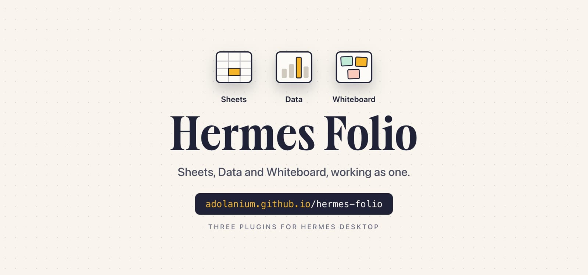
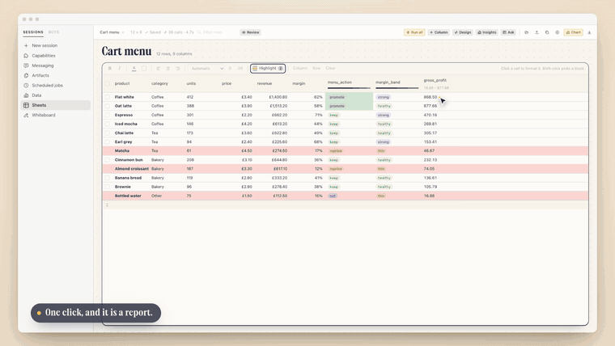
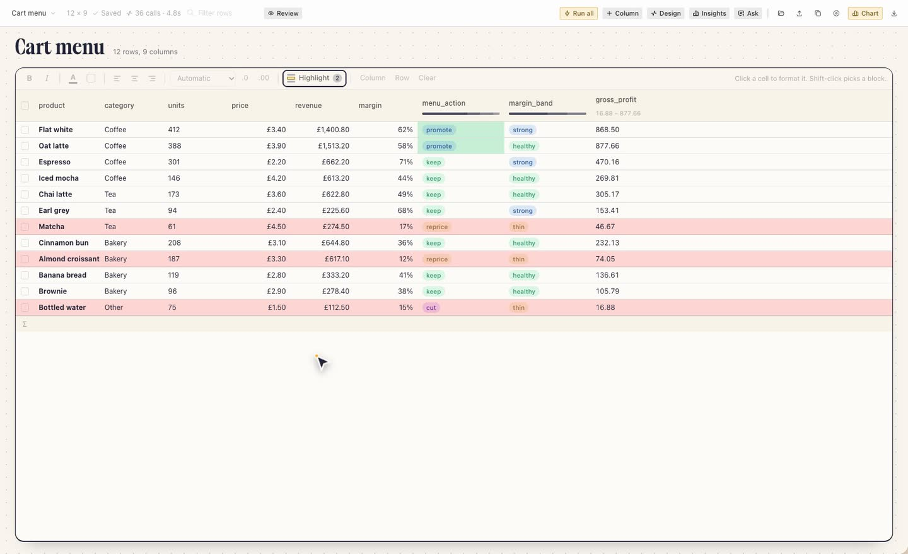
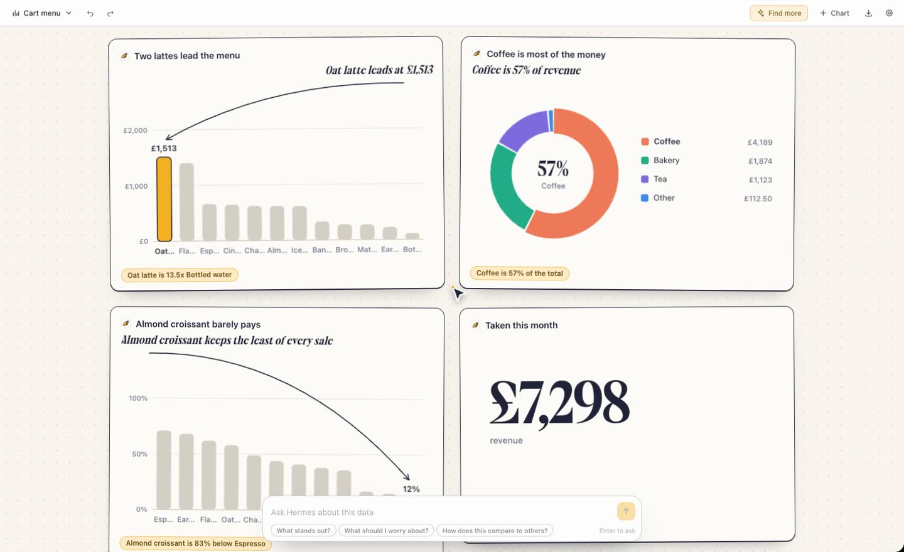
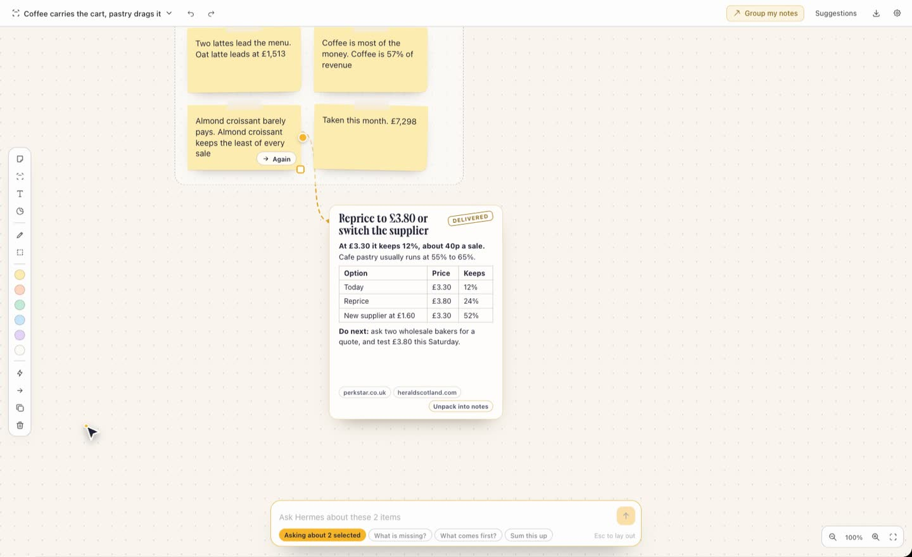
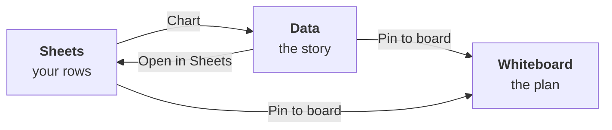
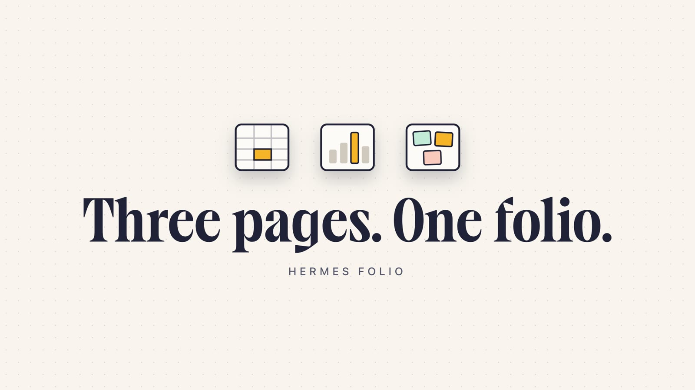

<div align="center">

<a href="https://adolanium.github.io/hermes-folio/"></a>

**Three plugins for Hermes Desktop that hand work to each other.**<br />
A sheet, a report and a board. Hermes suggests at every step, and nothing lands until you accept it.

[**Try the live demo**](https://adolanium.github.io/hermes-folio/#live) &nbsp;·&nbsp; [Watch the film](https://adolanium.github.io/hermes-folio/#film) &nbsp;·&nbsp; [Sheets](https://github.com/Adolanium/hermes-sheets) &nbsp;·&nbsp; [Data](https://github.com/Adolanium/hermes-data) &nbsp;·&nbsp; [Whiteboard](https://github.com/Adolanium/hermes-whiteboard)

</div>

<br />

<div align="center">



<sub>One click on <b>Chart</b> in Sheets, and the rows open as a report in Data. From the <a href="https://adolanium.github.io/hermes-folio/#film">85 second film</a>.</sub>

</div>

## Install

Each plugin needs Hermes 0.22.6 or later and nothing else.

All three with one command. Hermes shows the three plugins and their pinned versions, asks once, then installs them, and each plugin still asks for its own consent:

```bash
hermes plugins pack install https://raw.githubusercontent.com/Adolanium/hermes-folio/main/hermes-pack.yaml
```

Or one at a time, in any order:

```bash
hermes plugins install Adolanium/hermes-sheets
```

```bash
hermes plugins install Adolanium/hermes-data
```

```bash
hermes plugins install Adolanium/hermes-whiteboard
```

Then switch them on in Hermes Desktop under Capabilities, Plugins.

## The three pages

### 01 &nbsp; Sheets, a spreadsheet with an agent in every column

<a href="https://github.com/Adolanium/hermes-sheets"></a>

Open an Excel workbook or a CSV, or ask for a sheet and a Hermes agent finds the rows on the web. Hermes reads it and suggests columns worth adding. You tick the ones you want, and it answers every row.

- **Prompt columns.** Write a question once and get a typed, sortable answer for each row.
- **Real formatting.** Bold, colours, alignment, and currency or percent formats that never change the stored value.
- **Highlight rules.** Hermes proposes them from a summary of your columns, and you accept the ones you want.
- **Formulas, totals, Excel in and out.** The export keeps the formats and the fills.

[Sheets on GitHub →](https://github.com/Adolanium/hermes-sheets)

### 02 &nbsp; Data, a report where every number is computed, not written

<a href="https://github.com/Adolanium/hermes-data"></a>

Hermes reads the table and suggests a headline and a handful of charts, each making one point with an arrow to the mark it is about. You accept the ones you want onto the page.

- **The model never types a figure.** It picks columns and wording. The page works out every number from your rows.
- **Ask about the table, or about one chart.** When the table cannot answer, an agent searches the web and shows its sources.
- **Point at any mark** and the remark follows it. Split a chart by a second column, or redraw it as another type.
- **Export** a web page, Markdown, a chart as SVG, or the table as CSV.

[Data on GitHub →](https://github.com/Adolanium/hermes-data)

### 03 &nbsp; Whiteboard, a board where the notes get done

<a href="https://github.com/Adolanium/hermes-whiteboard"></a>

Say what you are planning and Hermes lays it out as a route, columns or a map. Add rough notes and it proposes groups and action items. Hand an action to Hermes and an agent does it on the board.

- **Results land next to the note,** with the sources the agent read.
- **Run the whole route.** Agents work each stop in order and leave a brief at the end.
- **Accept one by one.** Every suggestion can be taken back.
- **Select anything and ask.** The answer comes back as a card on the board.

[Whiteboard on GitHub →](https://github.com/Adolanium/hermes-whiteboard)

## Together

Each plugin works alone. Installed together, they pass the work on.



| Button | Where | What it does |
|---|---|---|
| **Chart** | Sheets | Opens the rows on screen as a new report in Data |
| **Open in Sheets** | Data | Opens a report's table as a new grid in Sheets |
| **Pin to board** | Data | Puts what each chart says on your open board, as a group of notes |
| **Pin to board** | Sheets | Puts the rows you ticked on your open board, one note each |

- **Only on a click.** A handoff starts from a button on the page you are on. No model is involved in it.
- **Always something new.** A table that arrives becomes a new grid or a new report. Notes land as one new group beside your board, and one undo takes them off again.
- **Nothing leaves the window.** The three pages run in one app window and pass the table with a browser event. No file is written and no backend is called for it. Other Desktop plugins you have switched on share that window and could read such an event.
- **A button only shows when the other plugin is on.**

## The same three rules on every page

1. **Hermes suggests. You decide.** Columns, rules, charts, groups and action items all wait as suggestions until you accept them.
2. **You can take it back.** Accepted changes can be undone, and an agent's change to a cell is marked until you touch it.
3. **Chat access starts off.** A Hermes chat can read your grids, reports and boards and propose changes only after you turn that on.

## About the film

<a href="https://adolanium.github.io/hermes-folio/#film"></a>

The [film on the site](https://adolanium.github.io/hermes-folio/#film) follows one workbook through all three pages in 85 seconds. It runs the real plugins in one window, so the handoffs in it are the real ones. Hermes' replies are scripted so the film can be recorded, and every number on screen is worked out by the plugins from the sample rows.

## This repository

This repository holds the site and the pack file. The plugins live in their own repositories, linked above.

- `index.html`, `site.css`, `site.js` and `assets/` are the page.
- `hermes-pack.yaml` is the plugin pack that the one-command install reads. It pins each plugin to an exact commit.
- `demo/` is the live demo on the site: the three plugins running in a browser against a stand-in for Hermes Desktop, with scripted replies. It includes interface code from Hermes Agent under its MIT licence; see [`demo/NOTICE.md`](demo/NOTICE.md).

To look at the site locally, serve the folder with any static server:

```bash
python3 -m http.server 8080
```

## License

MIT. An independent community project, not affiliated with Nous Research.
